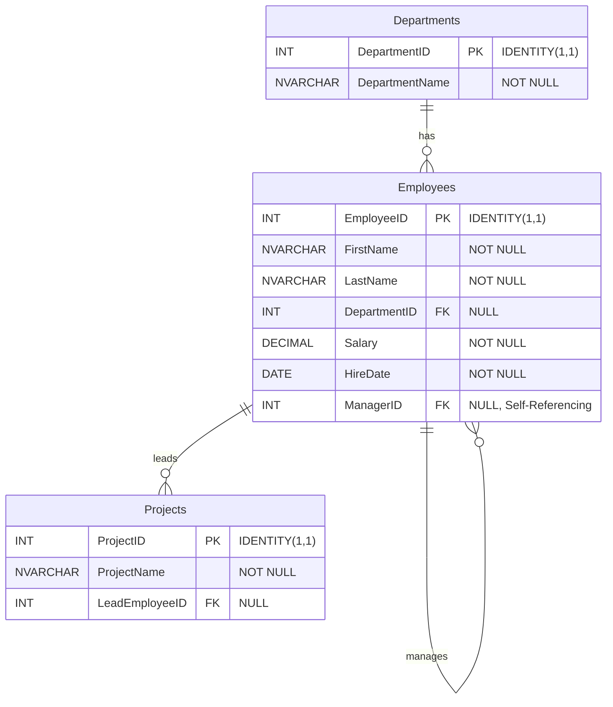

## T-SQL Execution & Architectural Overview

- **Topic:** RDBMS & SQL Server Programming
- **Instructor: RAHUL KP**

---

### Database Schema Architecture

The Entity-Relationship (ER) diagram below outlines the structural schema of the implementation environment, detailing primary keys, foreign key constraints, and relational cardinalities across the `Departments`, `Employees`, and `Projects` tables.



---

### Complete T-SQL Execution Script

```sql
-- ========================================================
-- RDBMS & SQL Server Programming: Comprehensive Script
-- Instructor: RAHUL KP
-- ========================================================

-- --------------------------------------------------------
-- STEP 1: DATABASE CREATION & CONTEXT SWITCHING
-- --------------------------------------------------------
CREATE DATABASE CompanyDB;
GO

-- Switch context to the newly created database
USE CompanyDB;
GO

-- --------------------------------------------------------
-- STEP 2: TABLE CREATION (DDL) WITH DATA TYPES & CONSTRAINTS
-- --------------------------------------------------------

-- Departments Table
CREATE TABLE Departments (
    DepartmentID INT IDENTITY(1,1) PRIMARY KEY,
    DepartmentName NVARCHAR(100) NOT NULL
);

-- Employees Table (Includes Foreign Key and Self-Referencing ManagerID)
CREATE TABLE Employees (
    EmployeeID INT IDENTITY(1,1) PRIMARY KEY,
    FirstName NVARCHAR(50) NOT NULL,
    LastName NVARCHAR(50) NOT NULL,
    DepartmentID INT NULL FOREIGN KEY REFERENCES Departments(DepartmentID),
    Salary DECIMAL(10, 2) NOT NULL,
    HireDate DATE NOT NULL,
    ManagerID INT NULL FOREIGN KEY REFERENCES Employees(EmployeeID)
);

-- Projects Table
CREATE TABLE Projects (
    ProjectID INT IDENTITY(1,1) PRIMARY KEY,
    ProjectName NVARCHAR(100) NOT NULL,
    LeadEmployeeID INT NULL FOREIGN KEY REFERENCES Employees(EmployeeID)
);
GO

-- --------------------------------------------------------
-- STEP 3: INSERTING DATA (DML)
-- --------------------------------------------------------

-- Insert Departments
INSERT INTO Departments (DepartmentName) VALUES
('IT'), ('HR'), ('Sales'), ('Marketing');

-- Insert Employees (Note: Eve Adams has NULL DepartmentID to test outer joins)
INSERT INTO Employees (FirstName, LastName, DepartmentID, Salary, HireDate, ManagerID) VALUES
('Rahul', 'KP', 1, 95000.00, '2021-01-15', NULL),
('Julia', 'Anna', 1, 75000.00, '2022-03-10', 1),
('Bob', 'Jones', 2, 60000.00, '2022-06-01', 1),
('Charlie', 'Brown', 3, 55000.00, '2023-01-20', NULL),
('Diana', 'Prince', 3, 72000.00, '2023-05-11', 4),
('Eve', 'Adams', NULL, 48000.00, '2023-09-01', NULL);

-- Insert Projects
INSERT INTO Projects (ProjectName, LeadEmployeeID) VALUES
('Cloud Migration', 1),
('HR Portal Redesign', 3),
('Sales Growth Q3', 4);
GO

-- --------------------------------------------------------
-- STEP 4: SQL SYNTAX, MODIFIERS & OPERATORS SHOWCASE
-- --------------------------------------------------------

-- A. Using TOP, Aliases (AS), and ORDER BY
SELECT TOP 3
    FirstName AS GivenName,
    Salary * 12 AS AnnualSalary
FROM Employees
ORDER BY Salary DESC;

-- B. Using Comparison & Logical Operators (AND)
SELECT FirstName, Salary, DepartmentID
FROM Employees
WHERE DepartmentID = 1 AND Salary > 70000;

-- C. Special Operators: BETWEEN, LIKE, and IS NULL
-- BETWEEN Operator
SELECT FirstName, Salary
FROM Employees
WHERE Salary BETWEEN 50000 AND 80000;

-- LIKE Operator (Pattern Matching)
SELECT FirstName
FROM Employees
WHERE FirstName LIKE 'A%';

-- IS NULL Operator
SELECT FirstName, DepartmentID
FROM Employees
WHERE DepartmentID IS NULL;
GO

-- --------------------------------------------------------
-- STEP 5: SQL JOINS DEMONSTRATION
-- --------------------------------------------------------

-- 1. INNER JOIN (Matches records present in BOTH tables)
SELECT e.FirstName, d.DepartmentName
FROM Employees AS e
INNER JOIN Departments AS d
    ON e.DepartmentID = d.DepartmentID;

-- 2. LEFT (OUTER) JOIN (All employees, matching departments or NULL)
SELECT e.FirstName, d.DepartmentName
FROM Employees AS e
LEFT JOIN Departments AS d
    ON e.DepartmentID = d.DepartmentID;

-- 3. RIGHT (OUTER) JOIN (All departments, matching employees or NULL)
SELECT e.FirstName, d.DepartmentName
FROM Employees AS e
RIGHT JOIN Departments AS d
    ON e.DepartmentID = d.DepartmentID;

-- 4. FULL OUTER JOIN (All records from both sides)
SELECT e.FirstName, d.DepartmentName
FROM Employees AS e
FULL OUTER JOIN Departments AS d
    ON e.DepartmentID = d.DepartmentID;

-- 5. CROSS JOIN (Cartesian Product)
SELECT t1.DepartmentName, t2.ProjectName
FROM Departments AS t1
CROSS JOIN Projects AS t2;

-- 6. SELF JOIN (Employee and their Manager relationship)
SELECT
    emp.FirstName AS EmployeeName,
    mgr.FirstName AS ManagerName
FROM Employees AS emp
LEFT JOIN Employees AS mgr
    ON emp.ManagerID = mgr.EmployeeID;
GO

-- --------------------------------------------------------
-- STEP 6: CLEANUP (DROP DATABASE)
-- --------------------------------------------------------
-- Switch back to master database before dropping CompanyDB
USE master;
GO

-- Drop the database to clean up server resources
DROP DATABASE CompanyDB;
GO

```

---

## Step-by-Step Technical Breakdown

To provide a thorough pedagogical understanding of engine behavior and implementation syntax, the execution script is systematically deconstructed into core architectural phases below:

### 1. Database Creation & Execution Context (`USE`)

- **`CREATE DATABASE`**: Initializes a brand-new logical database container within the designated SQL Server instance storage architecture.
- **`USE`**: Alters the active session context, guaranteeing that subsequent DDL and DML commands execute directly against `CompanyDB` rather than defaulting to system databases like `master`.

### 2. Table Schemas, Data Types, and Constraints (`DDL`)

- **`IDENTITY(1,1)`**: Implements automatic surrogate key generation, enforcing sequential integer values beginning at 1 and auto-incrementing with each subsequent insertion.
- **`NVARCHAR(n)`**: Allocates variable-length Unicode string storage, ensuring robust multi-language text compatibility and efficient resource allocation.
- **`DECIMAL(10, 2)`**: Enforces precision exact-numeric typing specifically chosen for fiscal data integrity, restricting values to ten total digits with exactly two reserved for fractional scale.
- **`FOREIGN KEY REFERENCES`**: Establishes explicit relational constraints to preserve referential integrity, ensuring that dependent child records cannot reference non-existent parent identifiers.

### 3. Modifiers, Aliases, and Conditional Operators

- **`TOP 3`**: Restricts the result set cardinality in a manner native to SQL Server, filtering output rows efficiently prior to final presentation.
- **`AS`**: Applies explicit column and table aliasing to enhance readability and resolve ambiguous references in multi-table queries.
- **`BETWEEN` & `LIKE**`: Utilizes specialized filtering predicates within the `WHERE` clause to perform inclusive range evaluations and wildcard pattern matching (`%` sequence matching), respectively.

### 4. Relational Join Mechanics

- **`INNER JOIN`**: Evaluates intersection criteria, filtering out records lacking mutual matches across both relations (e.g., omitting unassigned personnel like `Eve Adams` who lack a valid `DepartmentID`).
- **`LEFT JOIN`**: Preserves the complete dataset of the designated left-hand table (`Employees`), filling non-matching right-hand attributes with explicit `NULL` markers.
- **`RIGHT JOIN` / `FULL OUTER JOIN**`: Broadens data extraction to capture asymmetric or completely disjointed population sets, ensuring zero data omission across interrelated entities.
- **`SELF JOIN`**: Relates a table instance back onto itself via recursive keys (such as `ManagerID` mapping to `EmployeeID`), elegantly mapping hierarchical reporting structures.

### 5. Session Termination and Resource Cleanup

- **`USE master`**: Relinquishes active exclusive database locks by re-routing the execution context back to the system `master` database.
- **`DROP DATABASE`**: Safely terminates active connections, purges allocation structures, and completely removes the database instance from server storage to conserve resources.
