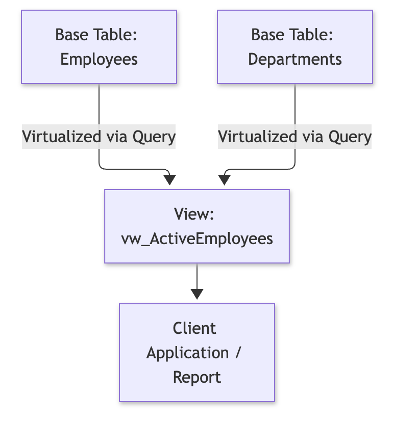

# SQL : Views, Triggers, Cursors & Stored Procedures (SQL Server)

- **Topic:** RDBMS & SQL Server Programming (Advanced Database Objects)
- **Instructor:** RAHUL KP

---

## SQL Views

### 1. What is a View?

A **View** is a database object that stores a pre-packaged `SELECT` query. It does not physically store the underlying data itself (unless it is an _Indexed View_); instead, it acts as a **virtual table** computed dynamically every time it is referenced.

### 2. Key Benefits of Views



- **Security & Abstraction:** Hides complex multi-table joins, calculations, and sensitive columns (like salaries) from end-users or reporting applications.
- **Consistency:** Centralizes complex business logic into a single database object so multiple applications query the exact same logic.

### 3. Creating and Using a View

```sql
-- Creating a view to abstract employee department details
CREATE VIEW vw_DepartmentDetails
AS
SELECT
    e.EmployeeID,
    e.FirstName + ' ' + e.LastName AS FullName,
    ISNULL(d.DepartmentName, 'Unassigned') AS DepartmentName,
    e.Salary
FROM Employees AS e
LEFT JOIN Departments AS d
    ON e.DepartmentID = d.DepartmentID;
GO

-- Querying the view just like a regular table
SELECT * FROM vw_DepartmentDetails WHERE Salary > 60000;

```

---

## Stored Procedures

### 1. Introduction to Stored Procedures

A **Stored Procedure** is a saved collection of T-SQL statements stored directly inside the database engine.

- **Performance:** Compiled the first time they run and cached as an execution plan for subsequent calls.
- **Security:** Prevents SQL injection attacks when parameters are handled correctly and restricts direct table access.

### 2. Creating a Stored Procedure with Parameters

```sql
-- Creating a procedure with input and output parameters
CREATE PROCEDURE sp_GetEmployeesByDepartment
    @DepartmentID INT,
    @TotalEmployeeCount INT OUTPUT
AS
BEGIN
    SET NOCOUNT ON;

    -- Select employee records for the department
    SELECT EmployeeID, FirstName, Salary, HireDate
    FROM Employees
    WHERE DepartmentID = @DepartmentID;

    -- Assign value to the output parameter
    SELECT @TotalEmployeeCount = @@ROWCOUNT;
END;
GO

```

### 3. Executing the Stored Procedure

```sql
-- Declaring a variable to capture the output parameter
DECLARE @Count INT;

-- Executing the procedure
EXEC sp_GetEmployeesByDepartment @DepartmentID = 1, @TotalEmployeeCount = @Count OUTPUT;

-- Printing the captured output result
PRINT 'Total employees found: ' + CAST(@Count AS VARCHAR(10));

```

---

## SQL Triggers

### 1. What is a Trigger?

A **Trigger** is a specialized type of stored procedure that automatically executes (fires) in response to specific database events (such as `INSERT`, `UPDATE`, or `DELETE` on a table).

### 2. Magic Tables: `INSERTED` and `DELETED`

SQL Server handles trigger data logging via two temporary, memory-resident logical tables:

- **`INSERTED`:** Contains copies of rows added or updated (post-image data).
- **`DELETED`:** Contains copies of rows deleted or updated (pre-image data).


### 3. Creating an Audit/Log Trigger

```sql
-- Creating a table to track salary modifications
CREATE TABLE SalaryAuditLog (
    LogID INT IDENTITY(1,1) PRIMARY KEY,
    EmployeeID INT,
    OldSalary DECIMAL(10,2),
    NewSalary DECIMAL(10,2),
    ModifiedDate DATETIME DEFAULT GETDATE()
);
GO

-- Creating an AFTER UPDATE trigger
CREATE TRIGGER trg_TrackSalaryChanges
ON Employees
AFTER UPDATE
AS
BEGIN
    SET NOCOUNT ON;

    -- If salary was modified, log the change
    IF UPDATE(Salary)
    BEGIN
        INSERT INTO SalaryAuditLog (EmployeeID, OldSalary, NewSalary)
        SELECT
            i.EmployeeID,
            d.Salary AS OldSalary,
            i.Salary AS NewSalary
        FROM inserted AS i
        INNER JOIN deleted AS d
            ON i.EmployeeID = d.EmployeeID
        WHERE i.Salary <> d.Salary;
    END
END;
GO

```

---

## Cursors & Best Practices

### 1. Understanding Cursors

Relational databases are designed for **set-based operations** (processing entire datasets at once). A **Cursor** breaks this paradigm by allowing row-by-row procedural iteration over a result set.

> ⚠️ **Performance Warning:** Cursors are notoriously resource-heavy and slow ("Rbar" - Row-By-Agonizing-Row). They should only be used when procedural row-by-row logic is strictly required (e.g., executing administrative routines or dependent sequential calculations).

### 2. Standard Cursor Lifecycle

1. **DECLARE** the cursor query.
2. **OPEN** the cursor.
3. **FETCH** rows one by one into local variables inside a loop.
4. **CLOSE** the cursor.
5. **DEALLOCATE** the cursor to free memory resources.

### 3. Practical Cursor Implementation

```sql
-- Declaring local variables for row processing
DECLARE @EmpID INT;
DECLARE @Fname NVARCHAR(50);
DECLARE @SummaryMessage NVARCHAR(200);

-- 1. Declare the cursor
DECLARE employee_cursor CURSOR FOR
SELECT EmployeeID, FirstName FROM Employees WHERE DepartmentID = 1;

-- 2. Open the cursor
OPEN employee_cursor;

-- 3. Fetch the first row
FETCH NEXT FROM employee_cursor INTO @EmpID, @Fname;

-- Loop through rows while fetch status is successful (0)
WHILE @@FETCH_STATUS = 0
BEGIN
    SET @SummaryMessage = 'Processing Employee ID: ' + CAST(@EmpID AS VARCHAR(10)) + ' - Name: ' + @Fname;
    PRINT @SummaryMessage;

    -- Fetch the next row
    FETCH NEXT FROM employee_cursor INTO @EmpID, @Fname;
END;

-- 4. Close the cursor
CLOSE employee_cursor;

-- 5. Deallocate the cursor memory
DEALLOCATE employee_cursor;
GO

```

---
